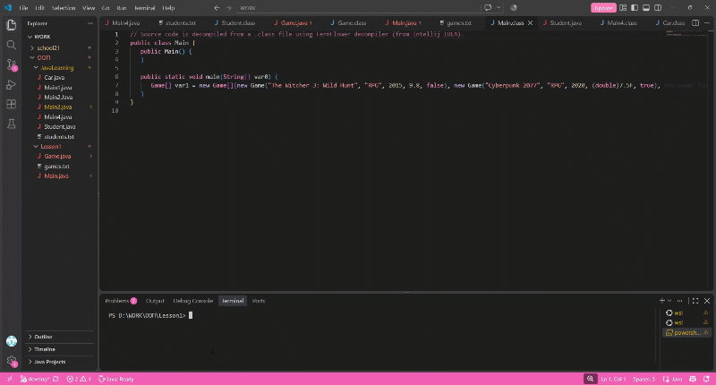

# Урок 1 — Каталог компьютерных игр

## Описание проекта

В программе создан каталог из 15 компьютерных игр. Каждая игра представлена объектом класса `Game`.

## Характеристики игры

Каждый объект содержит пять полей разных типов:

1. `title` — название игры (`String`);
2. `genre` — жанр (`String`);
3. `releaseYear` — год выпуска (`int`);
4. `rating` — рейтинг (`double`);
5. `isMultiPlaer` — наличие многопользовательского режима (`boolean`).

## Функциональность

Программа выполняет три вида сортировки:

1. По названию — в алфавитном порядке.
2. По рейтингу — от большего к меньшему.
3. По году выпуска — от новых игр к старым.

Для сортировки используется алгоритм пузырьковой сортировки с `Comparator<Game>`.

Результаты всех трёх сортировок записываются в файл `games.txt`.

## Структура проекта

1. `Main.java` — создание объектов, сортировка и запись результатов.
2. `Game.java` — класс игры с полями, конструктором и методом записи информации.
3. `games.txt` — результаты работы программы.
4. `lesson1.gif` — демонстрация запуска и работы программы.

## Демонстрация работы

